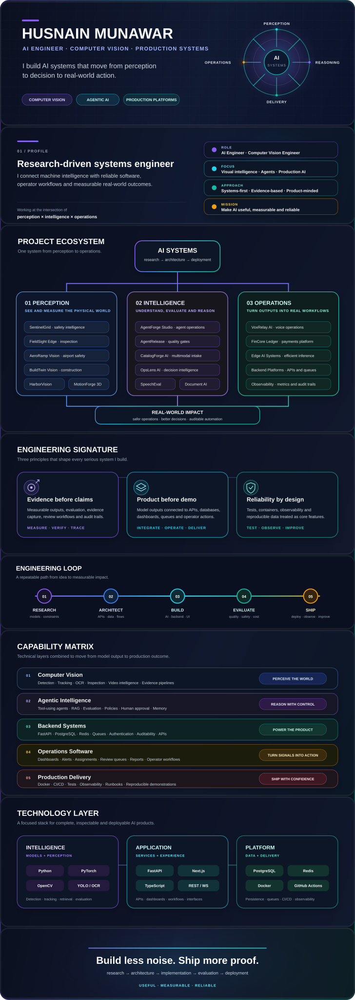

  

## What I build

I design AI systems that connect perception, reasoning, and operator workflows: computer vision, document intelligence, agent orchestration, and production-oriented APIs. My portfolio favors inspectable execution over screenshot-only demos—tests, traces, artifacts, failure handling, and explicit limits belong beside the model.

## Start with these repositories

| System | What to inspect |
|---|---|
| [VeriSwarm Orchestrator](https://github.com/HUSNAIN-MUNAWAR/veriswarm-orchestrator) | Bounded agent workflows, approvals, durable events, independent workspace verification, and benchmark limits. |
| [SceneMotion-3D](https://github.com/HUSNAIN-MUNAWAR/SceneMotion-3D) | Monocular visual odometry, triangulation, depth-assisted clouds, trajectory metrics, and honest relative-scale handling. |
| [FactoryVision OS](https://github.com/HUSNAIN-MUNAWAR/factoryvision-os) | Real CPU inspection pipeline with tracking, segmentation decisions, anomaly evidence, and release validation. |
| [FieldSight Edge](https://github.com/HUSNAIN-MUNAWAR/fieldsight-edge) | Offline capture queue, synchronization, deterministic inference boundary, and field report export. |
| [MotionForge 3D](https://github.com/HUSNAIN-MUNAWAR/motionforge-3d) | Local pose-estimation runtime with reproducible video, trace data, and annotated output. |
| [Change Order Intelligence](https://github.com/HUSNAIN-MUNAWAR/change-order-intelligence-platform) | Evidence-grounded extraction for PDFs/text/images, local OCR, provenance spans, validation, and schema-safe API output. |
| [AgentForge Studio](https://github.com/HUSNAIN-MUNAWAR/agentforge-studio) | Tool-using agent graphs, policy controls, approval gates, and explicit mock/provider boundaries. |
| [FinCore Ledger](https://github.com/HUSNAIN-MUNAWAR/fincore-ledger) | Double-entry payment processing, reconciliation invariants, idempotency, and local runtime evidence. |

## Engineering signature

- Evidence before claims: run the model or rule path, preserve outputs, and report what was unavailable.
- Product before demo: connect inference to APIs, storage, review states, exports, and operator decisions.
- Reliability by design: test failure paths, constrain side effects, scan secrets, and keep reproducible setup instructions.

## Portfolio status

As of 2026-11-23, all 26 supplied public-repository inventory entries have reconciled, evidence-backed work or an explicitly documented limitation. The current engineering checkpoint and visual-evidence matrix are maintained in the shared workspace, while each repository keeps its own runnable evidence.

The portfolio deliberately labels synthetic fixtures, fallback providers, OS services, mock agents, relative monocular scale, and unavailable frontend/provider checks. No benchmark or live-model result is claimed unless it was actually run and preserved in the repository.

## Visual system

The profile artwork is split into inspectable SVG assets: [hero](./hero.svg), [project ecosystem](./project-ecosystem.svg), [capability matrix](./capability-matrix.svg), [technology layer](./technology-layer.svg), [engineering signature](./engineering-signature.svg), and [engineering loop](./engineering-loop.svg). The composed [profile showcase](./profile-showcase.svg) is the GitHub landing visual.

## Contact

[GitHub](https://github.com/HUSNAIN-MUNAWAR) · [Email](mailto:husnainbinmunawar@gmail.com)
